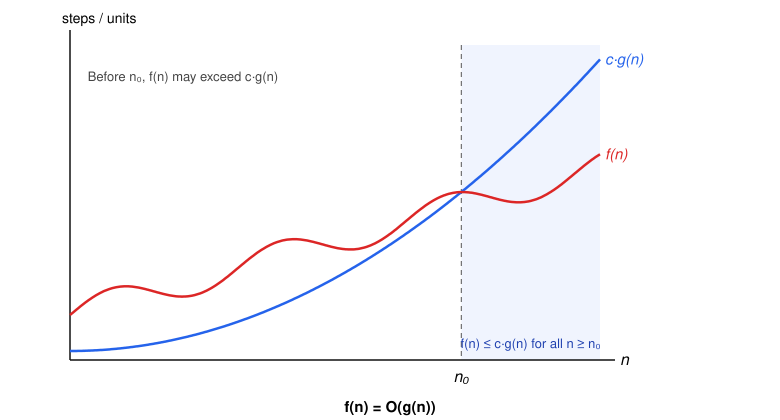
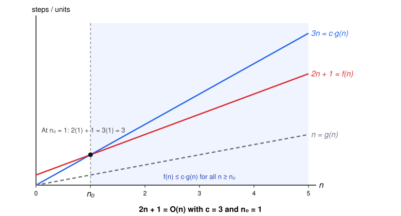

# Asymptotic Analysis

In the context of algorithms, asymptotic analysis is the process of characterizing how an algorithm's running time or memory usage grows as the input size grows arbitrarily large.

We focus on large inputs because that is where efficiency, meaning how much time and memory an algorithm uses, matters most. For small inputs, almost any algorithm runs quickly, but as inputs grow, an algorithm's growth rate outweighs factors such as hardware speed or implementation details. This allows us to compare algorithms independently of the machine they run on.

## Asymptotic Notation

### Preliminaries

#### Input size $n$

$n$ denotes the **input size**, the quantity used to measure how large an input is. What $n$ represents depends on the problem: it might be the number of elements in a list, the number of characters in a string, or the number of nodes in a graph.

Importantly, $n$ captures only the **size** of the input, not its **content**. Two inputs of the same size can therefore require different amounts of time or memory to process. For example, a sorted array and a reverse-sorted array have the same size, but a sorting algorithm may take much longer on one than the other.

#### Running time $T(n)$

$T(n)$ denotes the **running time** of an algorithm on an input of size $n$, measured by the number of **basic operations** it performs, such as comparisons, assignments, or arithmetic operations. Counting operations rather than seconds makes the measure independent of the machine on which the algorithm runs.

Because inputs of the same size can require different numbers of operations, we must specify which case $T(n)$ describes:

* **Worst case:** the maximum number of operations over all inputs of size $n$.
* **Best case:** the minimum number of operations over all inputs of size $n$.
* **Average case:** the expected number of operations over all inputs of size $n$, assuming a specified distribution of inputs.

Unless stated otherwise, $T(n)$ refers to the worst case, which guarantees that no input of size $n$ requires more than $T(n)$ operations.

#### Memory usage $S(n)$

$S(n)$ denotes the **memory usage** of an algorithm on an input of size $n$, measured in **units of space**, where each stored value, such as a number, a character, or a reference, counts as one unit. Counting units rather than bytes makes the measure independent of the machine on which the algorithm runs.

Unless stated otherwise, $S(n)$ refers to the worst-case **auxiliary space**: the maximum extra memory used at any point during execution, over all inputs of size $n$. This includes new variables and data structures as well as the call stack used by recursion, but excludes the space occupied by the input itself.

#### Functions $f(n)$ and $g(n)$

$f(n)$ denotes the function being analyzed. In general, $f(n)$ can be any mathematical function of $n$, but in the analysis of algorithms it is usually $T(n)$ or $S(n)$. In principle, $f(n)$ is the exact number of operations or units of space, such as $f(n) = 2n^2 + n + 1$.

$g(n)$ denotes a simpler **reference function**, such as $n$, $n \log n$, or $n^2$, used to describe how $f(n)$ grows. Rather than stating $f(n)$ exactly, we compare it against $g(n)$, ignoring constant factors and lower-order terms.

In practice, determining $f(n)$ exactly is often difficult or unnecessary: the count depends on what we consider a basic operation, and some algorithms are too complex to count precisely. Asymptotic notation lets us bound $f(n)$ by $g(n)$ without knowing $f(n)$ exactly.

### Big O

For a function $g(n)$, $O(g(n))$ is the **set** of functions that grow no faster than $g(n)$, up to a constant factor:

$$
O(g(n)) = \{\, f(n) : \text{there exist positive constants } c \text{ and } n_0 \text{ such that } 0 \le f(n) \le c \cdot g(n) \text{ for all } n \ge n_0 \,\}
$$

In other words, $g(n)$ is an **asymptotic upper bound** for $f(n)$: once $n$ is large enough ($n \ge n_0$), $f(n)$ never exceeds $g(n)$ scaled by $c$. The condition $0 \le f(n)$ requires $f(n)$ to be **asymptotically nonnegative**, which always holds for $T(n)$ and $S(n)$.

Since $O(g(n))$ is a set, we should write $f(n) \in O(g(n))$. By convention, however, we usually write $f(n) = O(g(n))$, an abuse of notation.

#### Example

**Claim:** $2n + 1 = O(n)$.

**Proof.** Choose $c = 3$. We need $0 \le 2n + 1 \le 3n$ for all $n \ge n_0$, so we solve each inequality:

- **Upper bound:** $2n + 1 \le 3n \iff 1 \le n$.
- **Lower bound:** $0 \le 2n + 1 \iff n \ge -\frac{1}{2}$, which holds whenever $n \ge 1$.

Both inequalities hold for all $n \ge 1$, so $n_0 = 1$. Therefore $2n + 1 = O(n)$ with $c = 3$ and $n_0 = 1$. $\blacksquare$

Not every $c$ works: with $c = 2$, the upper bound becomes $2n + 1 \le 2n \iff 1 \le 0$, which never holds.

#### Choosing a bound

$2n + 1$ is also $O(n^2)$ and $O(n^3)$, since any function that grows at least as fast as $n$ is also an upper bound. These statements are true but uninformative, so we always give the **tightest** bound, the one that grows at the same rate as $f(n)$: $O(n)$. We make this precise in the Big Theta section.

#### Big O and the worst case

Big O and the worst case are independent ideas. The case determines *which* function we analyze, such as the worst-case running time $T_{\text{worst}}(n)$ or the best-case running time $T_{\text{best}}(n)$; Big O describes *how* we bound it. For example, for insertion sort:

- $T_{\text{best}}(n) = O(n)$ (the best-case running time grows no faster than $g(n) = n$, up to a constant factor).
- $T_{\text{worst}}(n) = O(n^2)$ (the worst-case running time grows no faster than $g(n) = n^2$, up to a constant factor).

In interviews, "What's the Big O?" usually means the tightest upper bound on the worst-case running time, unless the average or amortized case is specified.
