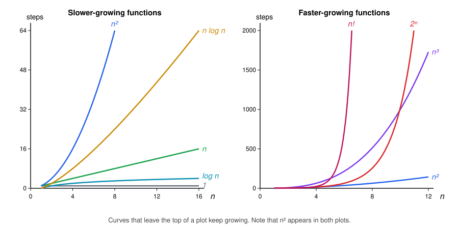

# Common Growth Rates

Most running times we meet in practice belong to a small set of functions. The table ranks them from slowest-growing to fastest-growing:

| Name | Function |
|---|---|
| Constant | $1$ |
| Logarithmic | $\log n$ |
| Linear | $n$ |
| Linearithmic | $n \log n$ |
| Quadratic | $n^2$ |
| Cubic | $n^3$ |
| Exponential | $2^n$ |
| Factorial | $n!$ |

Here, $\log n$ means the logarithm base $2$.

The plots below show the ranking as curves. The functions are split into two plots because $2^n$ and $n!$ grow so fast that, in a single plot, all the other curves would look flat:

## Comparing with Big O, Big Omega, and Big Theta

$$
O(1) \subset O(\log n) \subset O(n) \subset O(n \log n) \subset O(n^2) \subset O(n^3) \subset O(2^n) \subset O(n!)
$$

$$
\Omega(1) \supset \Omega(\log n) \supset \Omega(n) \supset \Omega(n \log n) \supset \Omega(n^2) \supset \Omega(n^3) \supset \Omega(2^n) \supset \Omega(n!)
$$

[Transitivity](06-transitivity.md) proves $\subseteq$ and $\supseteq$. The strict versions, $\subset$ and $\supset$, require additional proofs that we won't cover.

Big Theta sets don't nest. Big Theta requires both an upper and a lower bound, and the two chains above go in opposite directions.

## The ranking describes large inputs

In the right plot, $2^n$ starts below $n^3$. The curves cross near $n = 10$, and from there on $2^n$ stays above. Likewise, $n!$ starts below $n^3$ and passes it near $n = 5$.

This doesn't contradict the ranking. The definitions of Big O, Big Omega, and Big Theta only look at $n \ge n_0$, so what happens for small $n$ doesn't count.

The ranking describes large inputs. For small inputs, a function that grows faster can still be smaller.
