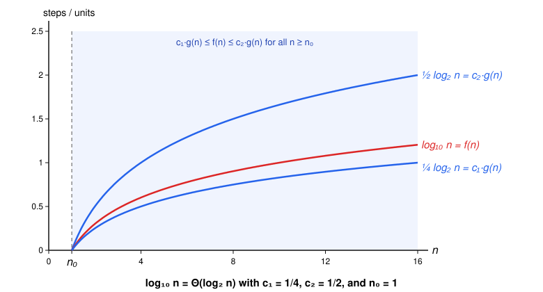
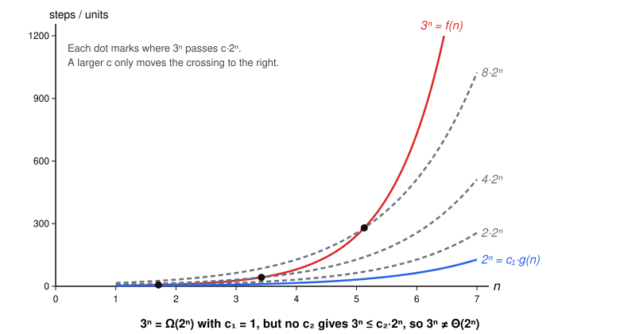

# Logarithm and Exponent Bases

Logarithms and exponential functions both have a base, but the base plays a different role in each. Changing the base of a logarithm doesn't change its growth rate. Changing the base of an exponential function does.

| Notation | Logarithm bases, $a, b > 1$ | Exponent bases, $a > b > 1$ |
|---|---|---|
| Big O | $\log_a n = O(\log_b n)$ | $b^n = O(a^n)$ but $a^n \ne O(b^n)$ |
| Big Omega | $\log_a n = \Omega(\log_b n)$ | $a^n = \Omega(b^n)$ but $b^n \ne \Omega(a^n)$ |
| Big Theta | $\log_a n = \Theta(\log_b n)$ | $a^n \ne \Theta(b^n)$ |

For example, $\log_{10} n = \Theta(\log_2 n)$, and $2^n = O(3^n)$ but $3^n \ne O(2^n)$.

## Logarithm bases don't matter

**Rule.** For any bases $a > 1$ and $b > 1$:

$$
\log_a n = \Theta(\log_b n)
$$

For example, $\log_{10} n = \Theta(\log_2 n)$.

This plot is a visual example. It uses $c_1 = \frac{1}{4}$ and $c_2 = \frac{1}{2}$.

**Proof.** By the definition of Big Theta, we need positive constants $c_1$, $c_2$, and $n_0$ such that, for all $n \ge n_0$:

$$
0 \le c_1 \cdot \log_b n \le \log_a n \le c_2 \cdot \log_b n
$$

1. The change-of-base formula rewrites a logarithm in base $a$ as a logarithm in base $b$:

   $$
   \log_a n = \frac{\log_b n}{\log_b a} = \frac{1}{\log_b a} \cdot \log_b n
   $$

2. Let $k = \frac{1}{\log_b a}$. It doesn't depend on $n$, so it's a constant. It's also positive, because $a > 1$ and $b > 1$ give $\log_b a > 0$. Step 1 becomes:

   $$
   \log_a n = k \cdot \log_b n
   $$

3. Choose $c_1 = c_2 = k$ and $n_0 = 1$. The chain to verify is:

   $$
   0 \le k \cdot \log_b n \le \log_a n \le k \cdot \log_b n
   $$

   For all $n \ge 1$, each part holds:

   - $0 \le k \cdot \log_b n$, because $k > 0$ and $\log_b n \ge 0$ for $n \ge 1$.
   - $k \cdot \log_b n \le \log_a n$, because by step 2 the two sides are equal.
   - $\log_a n \le k \cdot \log_b n$, for the same reason. $\blacksquare$

This is the same argument as in [dropping constant factors](02-dropping-constant-factors.md): $\log_a n$ is just $\log_b n$ multiplied by a positive constant.

This is why we write $O(\log n)$ without a base.

## Exponent bases matter

**Rule.** For any bases $a > b > 1$:

$$
b^n = O(a^n) \quad \text{but} \quad a^n \ne O(b^n)
$$

For example, $2^n = O(3^n)$ but $3^n \ne O(2^n)$. The function with the smaller base is in Big O of the one with the larger base, but not the other way around.

This plot is a visual example, not a proof. It shows only three values of $c_2$, and the proof below covers all of them.

Both proofs use the exponent rule $\frac{x^n}{y^n} = \left(\frac{x}{y}\right)^n$, which turns a ratio of two exponential functions into a single power.

**Proof that $b^n = O(a^n)$.** We need constants $c > 0$ and $n_0$ such that $0 \le b^n \le c \cdot a^n$ for all $n \ge n_0$.

1. Since $0 < b < a$, the ratio satisfies $0 < \frac{b}{a} < 1$. A power of a number between $0$ and $1$ is never more than $1$, so for all $n \ge 0$:

   $$
   0 < \left(\tfrac{b}{a}\right)^n \le 1
   $$

2. Multiply every part by $a^n$. Since $a^n > 0$, the inequalities keep their direction:

   $$
   0 < \left(\tfrac{b}{a}\right)^n \cdot a^n \le 1 \cdot a^n
   $$

3. By the exponent rule, $\left(\frac{b}{a}\right)^n \cdot a^n = \frac{b^n}{a^n} \cdot a^n = b^n$:

   $$
   0 < b^n \le 1 \cdot a^n
   $$

So $c = 1$ and $n_0 = 0$ work. $\blacksquare$

**Proof that $a^n \ne O(b^n)$.** Suppose $a^n = O(b^n)$. Then there are constants $c > 0$ and $n_0$ such that, for all $n \ge n_0$:

$$
a^n \le c \cdot b^n
$$

1. Divide both sides by $b^n$. Since $b^n > 0$, the inequality keeps its direction:

   $$
   \frac{a^n}{b^n} \le c
   $$

2. By the exponent rule:

   $$
   \left(\tfrac{a}{b}\right)^n \le c
   $$

3. Since $a > b$, the ratio satisfies $\frac{a}{b} > 1$. Each time $n$ increases by $1$, $\left(\frac{a}{b}\right)^n$ is multiplied by a number greater than $1$, so it keeps growing and eventually passes any constant $c$. This contradicts the inequality in step 2.

No constant works, so $a^n \ne O(b^n)$. $\blacksquare$

**Conclusion.** Since $a^n \ne O(b^n)$, the upper bound required by Big Theta fails, so $a^n \ne \Theta(b^n)$. Different bases give different growth rates, and the larger base grows faster. For example, $3^n \ne \Theta(2^n)$, which is why $O(2^n)$ and $O(3^n)$ are different.

## Big Omega

The logarithm rule is proved with Big Theta, so it also covers Big O and Big Omega. The exponent results also hold for Big Omega, as the table shows. We only prove the Big O and Big Theta versions here.
