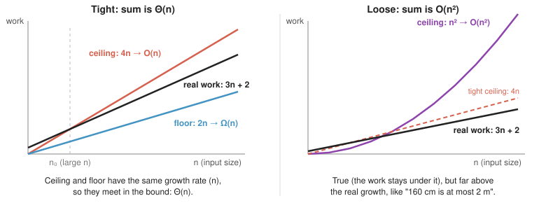

# Asymptotic Notation

## Pre-test (what I thought before)
<!-- Write this at the start of the session. Don't edit it later; it shows how far you came. -->
- I thought Big Omega was the maximum time and Big Theta was the minimum (wrong).
- I thought Big O was the "middle" case.
- Later, I called Big Theta "the average".

## In my own words
<!-- Explain it as if to someone who doesn't code. -->
Asymptotic notation is the language we use to describe how much work an algorithm does as its input size grows.

The symbols:
- **Big O:** the "at most" value, also called "the ceiling".
- **Big Omega (Ω):** the "at least" value, also called "the floor".
- **Big Theta (Θ):** the tight value. It holds only when O and Ω are equal.
- **Loose bound:** a ceiling far above the real growth.
- **Tight bound:** when O and Ω are equal.



## Key ideas
- In interviews, "what's the Big O?" usually means the tight bound for the worst case.
- Big O is the ceiling, Big Omega is the floor, and Big Theta is when they're equal.
- Constants are dropped: 3n + 2 becomes n, where n is the input size.
- The part inside the parentheses is the growth rate, e.g. the n² in O(n²).
- O(n), linear: time or memory grows proportionally to n (the input size).
- O(n²), quadratic: time or memory grows proportionally to n squared.
- Best vs. worst case: a case refers to which input the algorithm receives. The best case is the input that does the least work compared to other inputs of the same size, and the worst case does the most.
  - E.g. `find`: best Θ(1) (target at index 0), worst Θ(n) (target missing).

## Example (JavaScript)
```js
function hasDuplicates(arr) {
  for (let i = 0; i < arr.length; i++) {
    if (arr.slice(i + 1).includes(arr[i])) return true;
  }
  return false;
}

// Worst case: Θ(n²).
// Reasoning: the for loop runs n times. Inside it, slice + includes is 2n.
// Nested work multiplies: n x 2n → O(n²), quadratic.
```

## Exercises I solved
<!-- Include the exercise, your answer, and why. -->
1. `pairs`: O(n²), because the loops are nested.
2. `twice` (two loops one after the other): n + n = 2n, so O(n).
3. `hasDuplicate`: O(n²), because it's n x 2n.

## Mistakes I made
<!-- What did you get wrong during the session, and what's the correct idea? -->
1. I thought 3n + 2 was not linear (even guessed quadratic). Correct: when n doubles, 3n + 2 roughly doubles too, so it's linear. Constants don't change the growth rate.
2. I said "O is the input" / "O is the time x the input size". Correct: n is the input size, the part inside the parentheses is the growth rate, and O means "grows no faster than" (the ceiling).
3. I said `sum` is NOT O(n²) because it never reaches quadratic. Correct: O is "at most", so O(n²) is true for `sum`, just a loose bound. O(n) is the tight one.
4. I called Θ the "average" / "halfway point". Correct: Θ only exists when O and Ω are the same growth rate (tight bound). It's not a middle value.
5. I wrote the floor as O(n). Correct: the floor is Ω, so `sum` is Ω(n).
6. I said nested work is "outside + inside". Correct: sequential steps add (n + n = 2n → O(n)), nested steps multiply (n x n → O(n²)).

## Recall questions (for my spaced review)
1. What do O, Ω and Θ each say about growth, and when does Θ exist? (Why isn't Θ the "average"?)
2. Is `sum` (one loop over the array) O(n²)? Is that true, useful, or both, and what's the tight bound?
3. What's the difference between a "case" (best/worst) and a bound (O/Ω/Θ)? Give the best and worst case of `find` (linear search).
